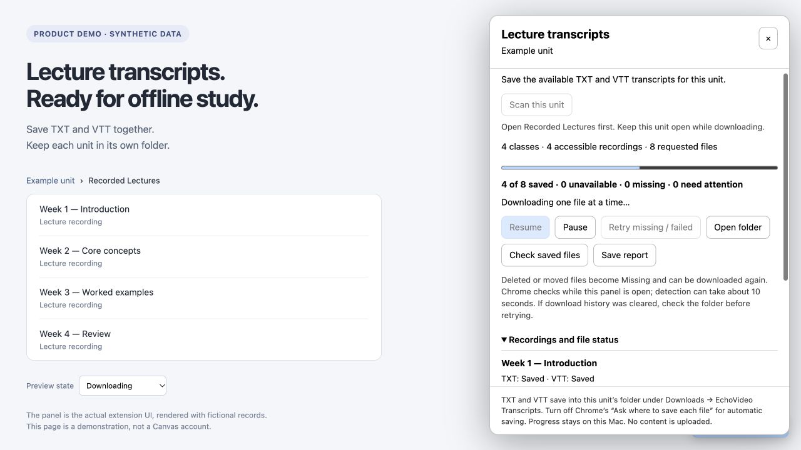

# Install Echo Transcript Companion

## 1. Download and keep the extension folder

Download **[EchoTranscriptCompanion-v1.1.0.zip](https://github.com/catsandsoup/echo-transcript-companion/releases/download/v1.1.0/EchoTranscriptCompanion-v1.1.0.zip)** from the release assets. Choose this install ZIP rather than GitHub’s separate **Source code** archives.

Unzip it. Move the extracted **EchoTranscriptCompanion** folder somewhere you can keep it permanently. Inside it, you should see `manifest.json` and the extension scripts. Keep that folder in place while the extension is installed.

## 2. Load it in Chrome

1. Open Chrome’s puzzle-piece **Extensions** menu, then **Manage Extensions**. You can also type `chrome://extensions` into the address bar.
2. Turn on **Developer mode** at the top right.
3. Click **Load unpacked**.
4. Select the extracted **EchoTranscriptCompanion** folder containing `manifest.json` — not the ZIP and not its parent folder.
5. Confirm **Assignment Dates — Echo Transcripts** appears and is enabled. That is the extension’s current name in Chrome.
6. Reload your Canvas tab.

Chrome documents the same [unpacked extension installation flow](https://developer.chrome.com/docs/extensions/get-started/tutorial/hello-world#load-unpacked).

## 3. Save your first unit

1. Open a University of Sydney Canvas unit’s **Recorded Lectures** class list. If a recording is open, use EchoVideo’s **Back** button.
2. Click **Lecture transcripts** at the bottom right of Canvas.
3. Choose **Scan this unit** and review the recording count and any availability notes.
4. Click **Download TXT + VTT**. Keep the source unit open while the batch runs.
5. After the first file is saved, use **Open folder** to reveal a saved transcript in the unit folder in Finder.

Both formats save under `EchoVideo Transcripts/<unit> [section suffix]/` inside Chrome’s configured download location, normally **Downloads**. Dates, lecture titles and distinct suffixes help keep similarly named recordings apart.

## Save automatically without a dialog for every file

In **Chrome Settings → Downloads**, turn off **Ask where to save each file before downloading**. This is a Chrome-wide preference, so it also affects other downloads.

## Pause, resume and retry

**Pause** stops new work after the current save. **Resume** continues pending files. **Retry missing / failed** retries removed or failed files and checks unavailable formats again, while preserving completed saves.

Deleted or moved files become **Missing** after Chrome detects their removal. This may take about ten seconds while the panel is open. [More about missing files →](docs/TROUBLESHOOTING.md)

*Actual extension interface with fictional demo records; no Canvas account data.*

## Update manually

This release has no automatic update service. For a future update:

1. Pause any active batch and wait for the current save to finish.
2. Unzip the new release. Replace the extension files **inside the same folder you originally loaded**, keeping its location and name.
3. Open **Manage Extensions** in Chrome and click **Reload** on the existing extension.
4. Reload Canvas, open the unit’s class list, then check the saved progress before resuming.

Reload the existing extension from the same folder to retain its identity and locally stored progress, then check progress before resuming. Future releases may include additional migration instructions. Chrome requires both the extension and host page to be reloaded after a content-script change. Do not remove the extension as an update step: removal clears its locally stored progress. Downloaded files remain on disk.

[Help with installation →](docs/TROUBLESHOOTING.md) · [Privacy and compatibility →](docs/PRIVACY.md)
