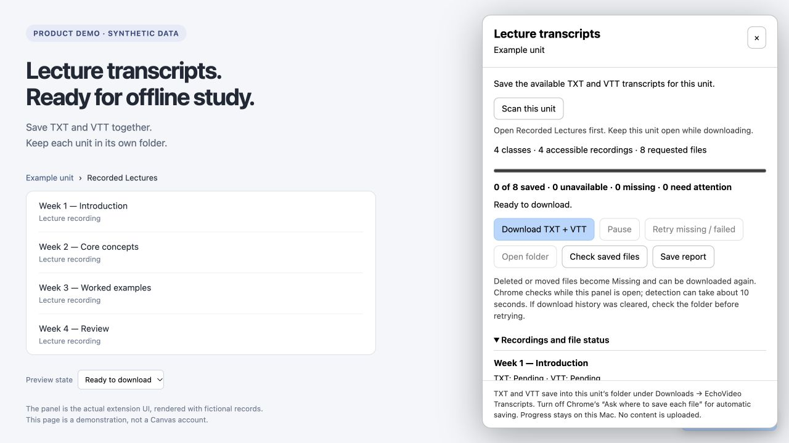

# Echo Transcript Companion

**Save your lecture transcripts for offline study.**

Download available EchoVideo transcripts from the Canvas unit you have open as TXT and VTT files, organised into a folder for that unit.

**Chrome on macOS · University of Sydney Canvas · Australian EchoVideo**

**[Download for Chrome (.zip)](https://github.com/catsandsoup/echo-transcript-companion/releases/download/v1.1.0/EchoTranscriptCompanion-v1.1.0.zip)**

[Installation guide](INSTALL.md) · [Release notes](https://github.com/catsandsoup/echo-transcript-companion/releases/latest) · [Get help](docs/TROUBLESHOOTING.md)

*Actual extension interface with fictional demo data. The surrounding page is a demonstration, not a Canvas account.*

## From recorded lectures to a folder you can use

- **Get both formats together.** Save readable TXT files and timestamped VTT files in one batch.
- **Keep your place.** Follow per-file progress, pause a batch, and resume pending downloads. Retry missing or failed files while retaining completed saves.
- **Find your transcripts quickly.** Filenames include the lecture date and title. **Open folder** reveals a saved transcript in its unit folder in Finder.

## Start with one unit

1. **Install the extension.** Download and unzip the release, then load its folder in Chrome using **Extensions → Manage Extensions → Developer mode → Load unpacked**. [Step-by-step instructions →](INSTALL.md)
2. **Open Recorded Lectures in Canvas.** Use EchoVideo’s **Back** button if you are already viewing a recording, so the class list is visible.
3. **Scan, then download.** Open **Lecture transcripts** at the bottom right, choose **Scan this unit**, then **Download TXT + VTT**. Keep that unit open while the batch runs.

Files go to `EchoVideo Transcripts/<unit> [section suffix]/` inside Chrome’s configured download location, normally **Downloads**.

**Want automatic saving?** Turn off Chrome **Settings → Downloads → Ask where to save each file before downloading**. This changes the setting for all Chrome downloads.

This release installs as an unpacked extension. It is not a Chrome Web Store listing, and updates are manual.

## Your study material stays on your computer

The extension uses your signed-in Canvas/EchoVideo session. No API key is required. Progress and class metadata are stored locally in Chrome; transcript files are saved to your computer. There is no analytics service or transcript upload.

The release contains code and documentation only. Product screenshots use fictional records and contain no Canvas account data.

## Know what is available

The extension saves formats that EchoVideo offers for the recordings found by the scan. Unavailable or restricted transcripts are shown in the results. If the scan warns about an unfamiliar or additional class list, completeness is not confirmed.

Current support is University of Sydney Canvas with Australian EchoVideo hosts, tested in Chrome on macOS. This is an independent project, not an official University, Canvas or EchoVideo product.

## Help and project details

- [Install and update](INSTALL.md)
- [Troubleshooting and missing files](docs/TROUBLESHOOTING.md)
- [Privacy, permissions and compatibility](docs/PRIVACY.md)
- [Development and verification](docs/DEVELOPMENT.md)
- [Report an issue](https://github.com/catsandsoup/echo-transcript-companion/issues) — omit private course data and transcripts.

Maintained by [catsandsoup](https://github.com/catsandsoup). Works on its own or alongside [Assignment Dates](https://github.com/catsandsoup/whenaremyassignmentsdue_mac).
