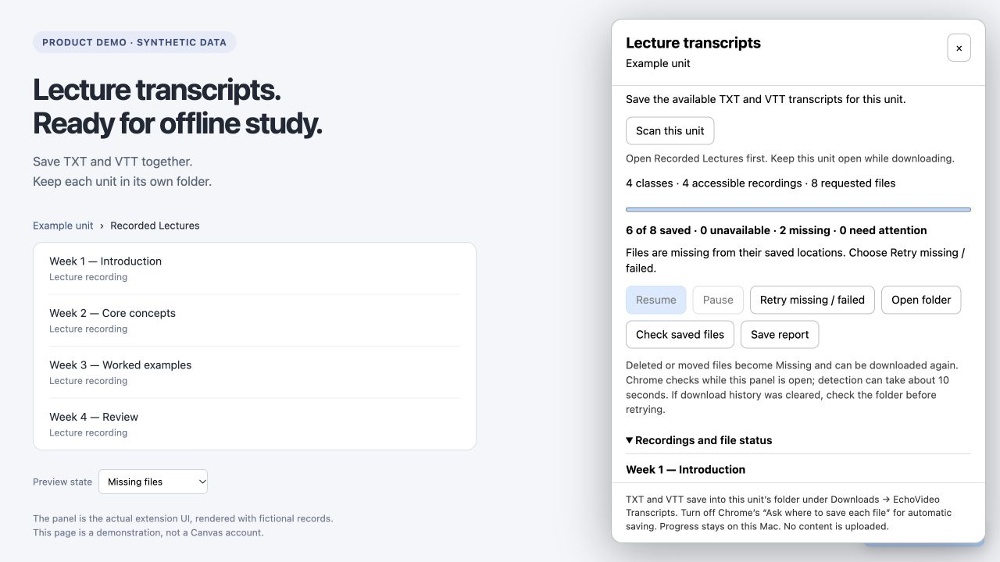

# Troubleshooting

## The Lecture transcripts launcher does not appear

Confirm the extension is enabled in Chrome’s **Manage Extensions**, then reload the Canvas page. The panel is added to University of Sydney Canvas unit pages. It does not appear on a standalone EchoVideo page or another institution’s Canvas site.

## “Open this unit’s Recorded Lectures class list”

Open **Recorded Lectures** in the unit you want. If EchoVideo is showing a recording, use its **Back** button to return to the class list. Wait for the list to load, then scan or resume. A newly launched individual recording may not provide enough section context to scan safely.

## Every file opens a Save dialog

Turn off **Chrome Settings → Downloads → Ask where to save each file before downloading**. This applies to all Chrome downloads. Keep the proposed filenames and unit folder if you choose to save through dialogs.

## I deleted or moved files, but the count still says Saved

Keep the panel open. It rechecks completed Chrome download records and updates when Chrome detects a missing file. Chrome’s existence information is cached, so detection can take about ten seconds. **Check saved files** requests another check.

A detected removal lowers the saved count and labels the file **Missing**. Choose **Retry missing / failed** to download it again. Intact completed files are retained.

*Actual extension interface with fictional records. The surrounding page is a demo, not Canvas.*

If Chrome download history was cleared, the extension may show **Check save** instead. The file could still exist, so inspect the folder before retrying to avoid duplicates. These checks concern Chrome’s recorded file locations; they do not continuously verify file contents.

## Open folder is unavailable

It becomes available after a file is saved into the unit folder. If every file is missing, retry a file first. On macOS, **Open folder** opens Finder with a saved transcript selected inside its unit folder.

## A format says Not available

EchoVideo did not offer that format for the recording. It may be pending, restricted or absent. The extension only requests formats advertised by EchoVideo. You can use **Retry missing / failed** later to check again.

## Downloads stopped after changing units or signing out

Reopen the original unit’s class list and sign in through the normal Canvas/EchoVideo flow if necessary, then choose **Resume**. Only one unit downloads at a time. Progress is retained locally, but the source unit must be open to continue fetching transcripts.

## A filename or folder is reported as wrong

The extension expects distinct filenames inside the proposed unit folder. A renamed file, an unexpected folder or a collision is flagged for retry. **Save report** records the actual saved paths for local troubleshooting. Reports can contain private class details and local paths; do not post them publicly.

## The scan reports an inventory warning

Review the availability notes. An unfamiliar or paginated class list prevents a confirmed completeness claim. Live grouped/paginated sections remain unverified. EchoVideo’s internal endpoints can also change.

## Report a problem

[Open an issue](https://github.com/catsandsoup/echo-transcript-companion/issues) with the extension version, browser version, action taken and visible error text. Remove names, course/recording IDs, account details, local user paths and transcript content from anything you share.
